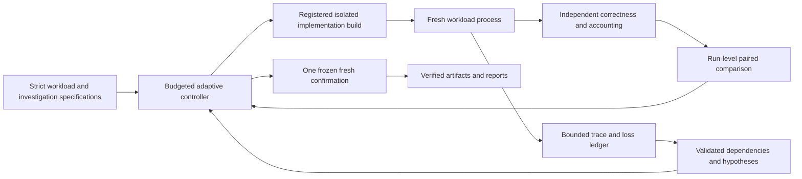

# Architecture

Application adapters define behavior, allowed parameters, launch arguments and validation. C++ drives open-loop requests through a bounded queue and worker pool, recording request identity, intended arrival, dispatch, response, process resources and explicitly supported regions. The three adapters preserve exact integer response contracts with independently implemented Python oracles.

`spec.py`, `investigation_spec.py` and `search.py` validate behavior and the closed search space. Workload generation is deterministic; timing is not. `runner.py` handles ordinary processes and immutable bundles, while `process.py` handles timeout/interrupt cleanup. `variants.py` freezes sources and isolates candidate engines. No controller action edits the live baseline.

`trace_reader.py` checks event grammar, resources, ownership, FIFO/capacity, phase clocks and loss accounting before `dependencies.py` derives temporal evidence. `diagnostics.py` produces hypotheses. Diagnostic schema 1 remains readable; schema 2 distinguishes supported observed ownership from substantial unattributed waiting. Graph edges do not constitute arbitrary causal proof or an additive critical path.

`statistics.py` compares independent process-level pairs with conservative median bounds and explicit sufficiency/constraint checks. `investigation.py` owns journal transitions, selection, budgets, one frozen finalist and fixed fresh confirmation. Online comparisons reuse already validated in-memory summaries; final verification opens raw child evidence anew and validates each child once per pass. Each final verification creates a fresh content-identity cache. Source archives are hashed at every path; identical archive/inventory decompression is checked once within that pass. Raw requests and reports are validated independently. No implicit cache survives across separate CLI verification calls.

`storage.py` supplies atomic JSON replacement, source inventories, regular-file archives, content hashes and semantic checks. Hashes detect changes; they are not a signature or a guarantee against a person intentionally fabricating an entirely new experiment. `transport.py` packages verified evidence using bounded content-addressed chunks and verifies restoration before reuse.

Generated catalogs under `docs/evidence/` are retained in Git and release assets rather than copied into every later process source snapshot. They are derived experiment evidence, not build input. The explicit inventory still captures application, controller, tests, examples, build configuration, upstream code and other documentation. Archived inventories are verified as recorded, including older capture policies.

`evaluation.py` freezes one source snapshot for a whole plan, interleaves strategy order under recorded seeds, retains all outcomes and records full wrapper time/storage. `calibration.py` generates explicitly synthetic statistical controls. `tools/evaluate_diagnostics.py` reuses test trace fixtures for transparent mechanism controls; it is evaluation tooling, not measured application behavior.

The installation exposes `jitter_runner.cli:entrypoint`; `tools/jitter.py` uses the same signal-aware source entry point. Reports are terminal, JSON and Markdown. There is no web dashboard or external model dependency.

## Evidence and trust boundaries

The supported C/C++ engines and local build tools are trusted measurement integrations. Subprocesses use argument vectors, inherited process-group cleanup and bounded timeouts. This is not an execution sandbox for hostile compilers or applications. Third-party source hashes, exact executable bytes, build configuration, source archives, inputs, host details and algorithm/schema identifiers are retained.

Exact binary reproduction requires the recorded OS and architecture; current tools reject a cross-platform binary replay. A different host can validate the saved raw evidence without executing it, or rebuild the archived source for a new investigation. Those new timings are new evidence.

Legacy standalone schemas and diagnostic schema 1 remain verified under their original contracts. New adapters, hypotheses or output fields require explicit format handling and compatibility checks, rather than silently reinterpreting old measurements.
